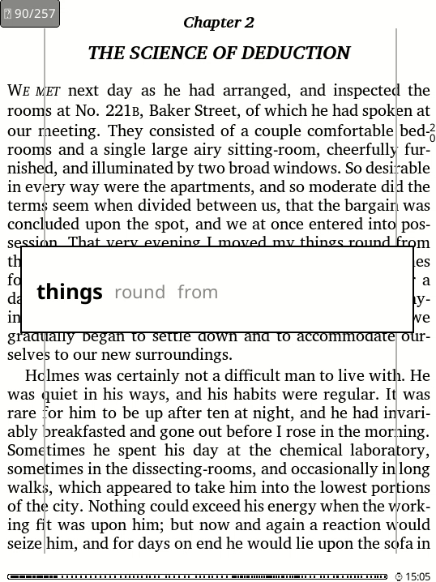
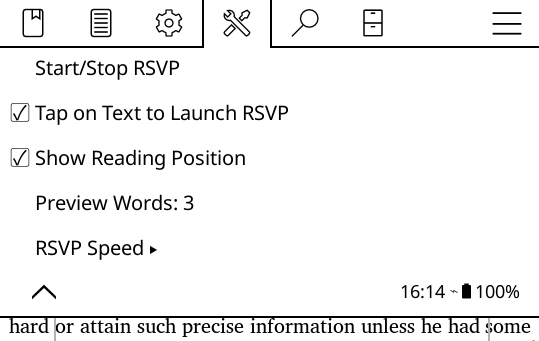

# FastReader Plugin for KOReader

A powerful RSVP (Rapid Serial Visual Presentation) plugin that enables speed reading with advanced features for KOReader.

## Features

- Tap-to-Launch RSVP: Tap directly on text to instantly start RSVP reading
- Resume Reading: Automatically remembers your last reading position on each page
- Flexible Speed Control: Adjustable reading speed from 50 to 1000 WPM
- Multi-Word Preview: Display multiple words simultaneously (1-10 words configurable)
- Optimal View Point Alignment: Optionally anchor each word on a focus crosshair for faster fixation
- Fixed-Width Display: Stable reading widget that doesn't "jump" between words
- Position Tracking: Visual indicator shows reading progress when resuming
- Seamless Page Transitions: Automatically continues to next page when reaching end

## Screenshots

### RSVP Reading Widget

Reading at 400 words per minute

### Settings Menu


## Installation

1. Run `make package` and extract `dist/fastreader.koplugin.zip` into KOReader's
   `plugins/` directory. For a source installation, copy `main.lua`, `_meta.lua`
   and the complete `fastreader/` directory into `plugins/fastreader.koplugin/`.
2. Restart KOReader
3. Enable the plugin in Settings → More Tools -> Plugins → FastReader

## Usage

### Quick Start
1. **Enable Tap-to-Launch**: Settings → FastReader → "Tap on Text to Launch RSVP"
2. **Set your speed**: Settings → FastReader → "RSVP Speed"
3. *(Optional)* Enable or disable the "Optimal Alignment (OVP)" toggle to choose between centered words and crosshair alignment
4. **Tap on any text** to start speed reading
5. **Tap the reading widget** to stop

### Manual Start
- Go to Settings → FastReader → "Start/Stop RSVP"
- Or use the assigned gesture if configured

### Controls During Reading
- **Tap anywhere on the reading widget** to stop RSVP
- **Menu/Back button** to stop RSVP
- **Page forward/back** to navigate (if RSVP is paused)
- **Tap elsewhere** to stop and return to normal reading

## Settings

### Main Settings
- **Start/Stop RSVP**: Manual control for RSVP reading
- **Tap on Text to Launch RSVP**: Enable/disable tap-to-start functionality
- **Show Reading Position**: Toggle position indicator when resuming
- **Preview Words**: Set number of words to display (1-10)
- **Optimal Alignment (OVP)**: Align words around the focus crosshair (monospace) or center them with standard spacing
- **RSVP Speed**: Comprehensive speed control options

### Speed Presets
- **100 WPM**: Very slow (beginners)
- **150 WPM**: Slow (comfortable reading)
- **200 WPM**: Normal (average reading speed)
- **250 WPM**: Fast (experienced readers)
- **300 WPM**: Very fast (advanced users)
- **400 WPM**: Extreme (speed reading experts)
- **500 WPM**: Ultra fast (maximum speed)

## Tips for Effective Speed Reading

1. **Start Slow**: Begin with 150-200 WPM and gradually increase
2. **Focus on Comprehension**: Speed is useless without understanding
3. **Use Preview Words**: Set to 3-5 words for better context
4. **Regular Practice**: Consistency improves reading speed over time
5. **Minimize Subvocalization**: Avoid "hearing" words in your head
6. **Use Resume Feature**: Take breaks and resume exactly where you left off

## Troubleshooting

### RSVP Won't Start
- Ensure the document has extractable text
- Try manually starting RSVP from the menu first
- Check that tap-to-launch is enabled in settings

### Text Extraction Issues
- Some PDF files may have non-extractable text
- Try converting to EPUB format for better compatibility
- Ensure the document is not password-protected

### Performance Issues
- Reduce preview word count if the interface feels slow
- Lower the reading speed if words appear too quickly
- Restart KOReader if the plugin becomes unresponsive

## Technical Details

- **Supported Documents**: PDF, EPUB, MOBI, and other text-based formats
- **Memory Efficient**: Minimal resource usage during operation
- **Page Tracking**: Uses content hashing for reliable position tracking
- **UTF-8 Compatible**: Works with international characters and languages

## License

This plugin is distributed under the [MIT License](LICENSE).

## Plugin metadata and updates

`_meta.lua` contains the display name, RSVP description, literal version, author,
MIT license and repository URL. KOReader uses the display metadata; ZenPM reads
the literal version when identifying an installed plugin. A `-dev` suffix marks
an unreleased development build.

ZenPM's catalog metadata comes from its repository index. The plugin is already
listed there as `koreader-rsvp-plugin`; adding fields locally does not publish a
GitHub release or replace the catalog's source-package version. Release archives
use a single `fastreader.koplugin/` directory with all runtime modules.

## Contributing

Contributions are welcome! Please submit issues and pull requests through the appropriate channels.

Tests use Busted/Luassert and LuaCov, following KOReader's test conventions.
From the plugin directory:

```sh
make test                      # isolated Busted specs (LuaJIT by default)
make test LUA=lua5.1
make coverage                  # LuaCov report
make integration               # native KOReader specs via its Meson/Busted runner
make check-all                 # lint, syntax, unit/real KOReader tests and installed ZIP
make package-check             # build ZIP and test the extracted installation
```

The isolated specs need Busted and LuaCov for Lua 5.1. Native integration also
needs a built KOReader emulator and Python 3; it runs headlessly with real
ReaderUI, document providers, widgets and UIManager in a temporary environment.
Set `KOREADER_DIR=/path/to/koreader` if the plugin is outside that checkout.
GitHub Actions runs both layers. See [Testing](docs/testing.md) for dependency
setup, upstream test discovery and the remaining device checks.
Runtime responsibilities are split under `fastreader/`; `main.lua` keeps the
KOReader entry points. Contributor and release requirements are in [AGENTS.md](AGENTS.md).

---

**Enjoy your enhanced reading experience with FastReader!** 📚⚡
